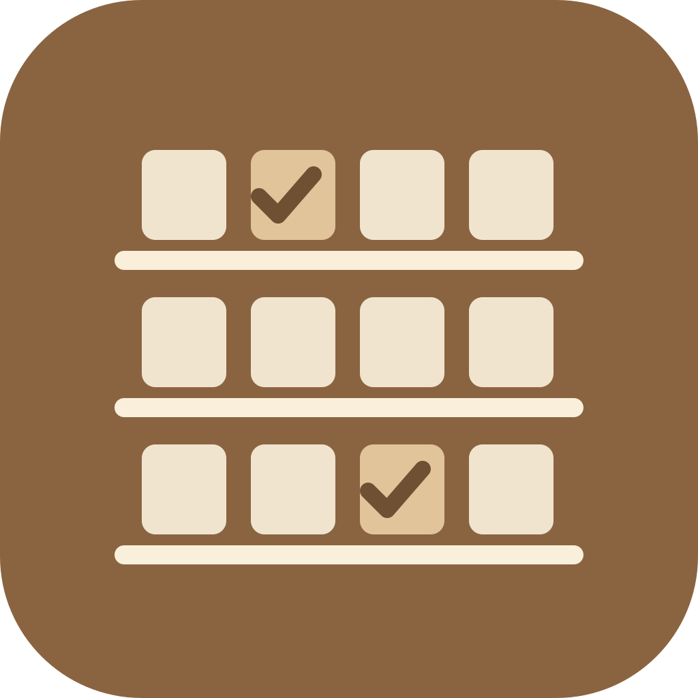
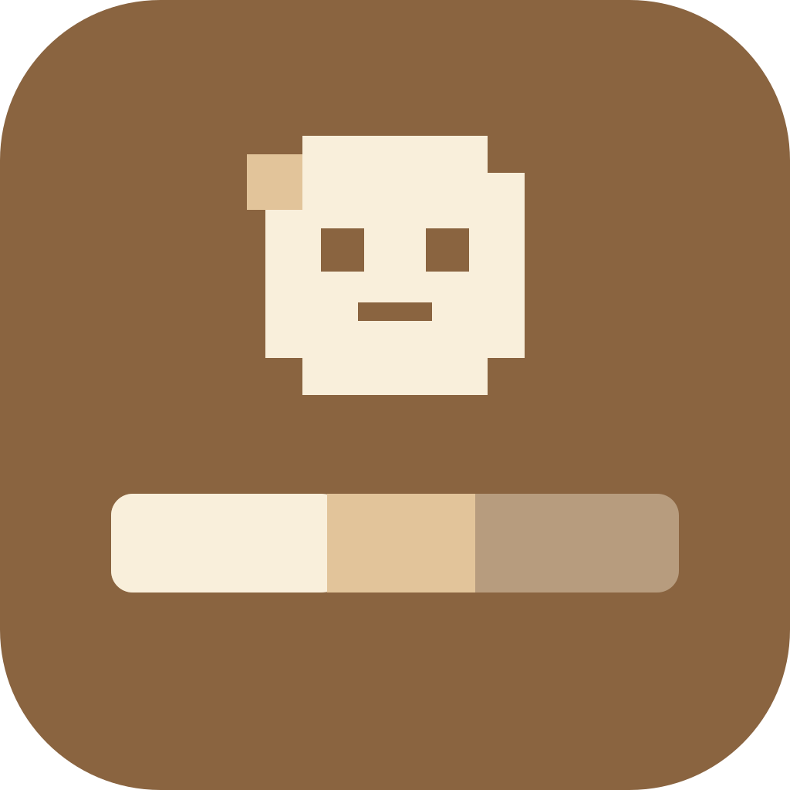

# Claude Code skills

Skills and mods I built for my own Claude Code setup. More about each one is on
[ibrahimelkhansa.com/claude-code-skills](https://ibrahimelkhansa.com/claude-code-skills).

| | Name | Type | What it does |
|---|---|---|---|
|  | [study-competition](plugins/study-competition/skills/study-competition) | Skill | Studies the market around a business idea. It finds the competitors and their prices, their ads, what their customers complain about, the gaps nobody fills, and where the idea already works abroad. It ends with selling points, video hooks and advice. |
|  | [explain-n8n](plugins/explain-n8n/skills/explain-n8n) | Skill | Explains a piece of code as an interactive workflow page in the style of n8n, with steps, branches, loops, the real code lines and example runs you can play. |
|  | [open-choices](plugins/open-choices/skills/open-choices) | Skill | Turns a wide open choice into a page of dozens of options on shelves. You mark Want or Maybe, and Claude reads your marks back. |
|  | [trim-clip](plugins/trim-clip/skills/trim-clip) | Skill | Keeps the last 30 seconds of a game clip (or any length you ask for) as a small 1080p MP4 on your Desktop. The original is never touched. |
|  | [toolbar](plugins/toolbar) | Mod | Adds a band above the prompt with the chat's pixel character and its helper agents, what files changed, and the context window as a stacked bar. |
|  | [usage-watch](plugins/usage-watch) | Mod | Answers `/usage-now` and `/cost-now` in chat, and has Claude tell you when the five hour window passes 80% or the context passes 70% and 85%. |

## Install

In Claude Code, add this repo as a plugin marketplace once:

```text
/plugin marketplace add Ibrahim-ElKhansa/claude-code-skills
```

Then install only the ones you want:

```text
/plugin install trim-clip@ibrahim-elkhansa
/plugin install study-competition@ibrahim-elkhansa
```

A skill installed this way runs as `/<plugin>:<skill>`, for example `/trim-clip:trim-clip`. You can also copy a
skill's folder (the one with `SKILL.md`) to `~/.claude/skills/<name>/` and run it as `/<name>`.

## Requirements

- **Claude Code.** The two mods need version 2.1.287 or later, and 2.1.299 or later to draw in the VS Code chat panel.
- **explain-n8n and open-choices** publish their page as a private claude.ai artifact when Claude's artifact tool is
  available. Without it, they write a single HTML file you open in your browser.
- **trim-clip** needs Python 3 and ffmpeg. It works on Windows, macOS and Linux.
- **study-competition** needs web search. A browser tool (such as Claude in Chrome) and the
  [watch](https://github.com/mathiaschu/claude-video) skill let it read ad libraries and watch video ads, but both are
  optional.

## What they will not do

None of these skills pay for anything, sign in, post or send on your behalf. study-competition only reads public pages,
and asks before it looks at pages in your browser. trim-clip writes a new file and never changes or deletes the
recording. The mods only draw and read what Claude Code already knows about the session. They send nothing anywhere.

## License

MIT, see [LICENSE](LICENSE). The toolbar's pixel characters come from
[pixel-agents](https://github.com/pixel-agents-hq/pixel-agents) by Pablo De Lucca, also MIT
([its license](plugins/toolbar/LICENSE-pixel-agents.txt)).

If one of these saves you time, a star helps other people find it.
